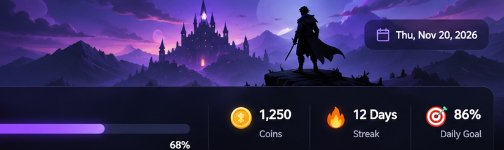

# 🎮 ProductivityQuest – Gamified Productivity System

A modern, full-stack, gamified web application that transforms daily tasks, habit building, and focus time into an immersive RPG quest. Built to strictly match the neon dark-purple fantasy dashboard design and SRS specification.



---

## ✨ Features

### 👑 Gamified Dashboard & Hero Profile
- **Hero Card:** Custom avatar with crown badge, rank title (*Productivity Warrior*), level badge, and XP progress bar with percentage.
- **Dynamic Stats:** Coins ($), Streak counter (Days), and Daily Goal completion percentage.
- **Level Ascension:** Automatic level-up logic carrying over excess XP with celebratory animations, sound fanfares, and confetti!

### 📝 Task & Habit Management
- **Today's Tasks:** Checklist with custom difficulty and XP values (`+15` to `+40` XP).
- **Gamification Rules:** Completing a task awards XP, coins, and Arcade Tokens. Unchecking a task reverses awarded rewards (GR-10 anti-exploit rule).
- **Task Quests View:** Full task manager with search, category filters (Study, Work, Health, Personal), priorities (High, Medium, Low), and recurrence support.

### ⏱️ Focus Sanctum (Pomodoro Technique)
- **3 Modes:** Pomodoro (25:00), Short Break (5:00), and Long Break (15:00).
- **Circular Glow Timer:** SVG progress ring with millisecond-accurate timestamp tracking (remains accurate even when the browser tab is in background).
- **Focus Rewards:** `+50 XP`, `+25 Coins`, and `+2 Arcade Tokens` awarded on every completed focus session.

### ⚔️ Quest Games & Arcade Zone
- **Dungeon Boss Raid:** Turn-based RPG boss fights against monsters of procrastination (*Sloth Golem*, *Procrastination Wyrm*, *Chronos the Deadline Titan*). Your stats scale with your real-life level and streak!
- **Mythic Fortune Wheel:** 8-wedge prize wheel with real deceleration physics and audio clicks to win coins, XP boosters, and Streak Freeze shields.
- **Rune Memory Matrix:** 16-card matching memory challenge with combo multipliers, speed scoring, and coin/XP payouts.
- **Cyber Runner:** 60 FPS HTML5 Canvas arcade game dodging red distraction lasers while collecting coins and XP stars.

### 🏆 Achievements & Rewards Store
- **Predefined Achievements:** Hexagonal badges for milestones (*First Task*, *3-Day Streak*, *Week Warrior*, *Focus Master*, *Dragon Slayer*, *Arcade Legend*).
- **Personal Rewards Store:** Spend gold coins on self-defined rewards (*30 min Gaming*, *Movie Night*, *Favourite Snack*, *Streak Freeze Shields*) with a Claimed/Used status vault.

### 📊 Analytics & Ledger
- **Interactive Charts (Recharts):** Tasks completed per day/week, focus minutes over time, and cumulative XP progression.
- **Transaction Ledger:** Full audit log of all XP and coin transactions.
- **CSV Export:** Download full productivity ledger as CSV with a single click.

---

## 🚀 Quick Start

### Prerequisites
- Node.js (v18+)
- npm or pnpm

### Installation
```bash
# Clone the repository
git clone https://github.com/mohamedrayhankhan25bca036-droid/Gamified-productivity-system.git
cd Gamified-productivity-system

# Install dependencies
npm install

# Run frontend development server
npm run dev

# Or build and launch the full-stack server
npm run build
npm start
```

Open [http://localhost:4000](http://localhost:4000) (or [http://localhost:5173](http://localhost:5173) for dev mode) in your browser.

---

## 🛠️ Tech Stack
- **Frontend:** React 18, TypeScript, Tailwind CSS, Vite, Lucide Icons, Canvas Confetti, Recharts
- **Audio:** Web Audio API 8-bit synthetic sound engine
- **Backend:** Node.js, Express REST API
- **Design:** Neon Dark-Purple Glassmorphism
